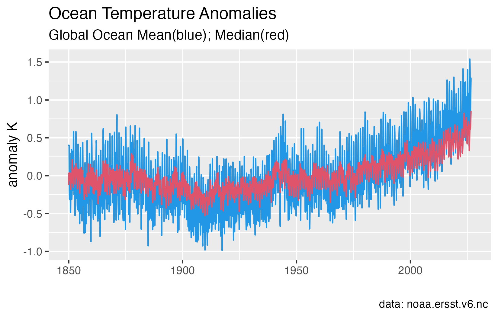
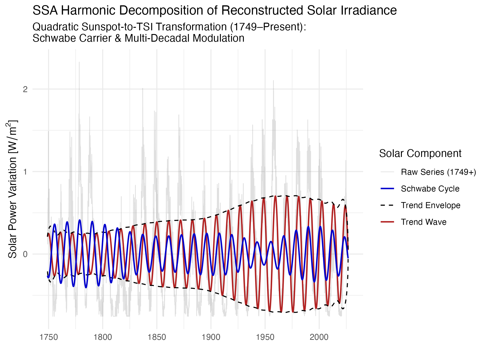
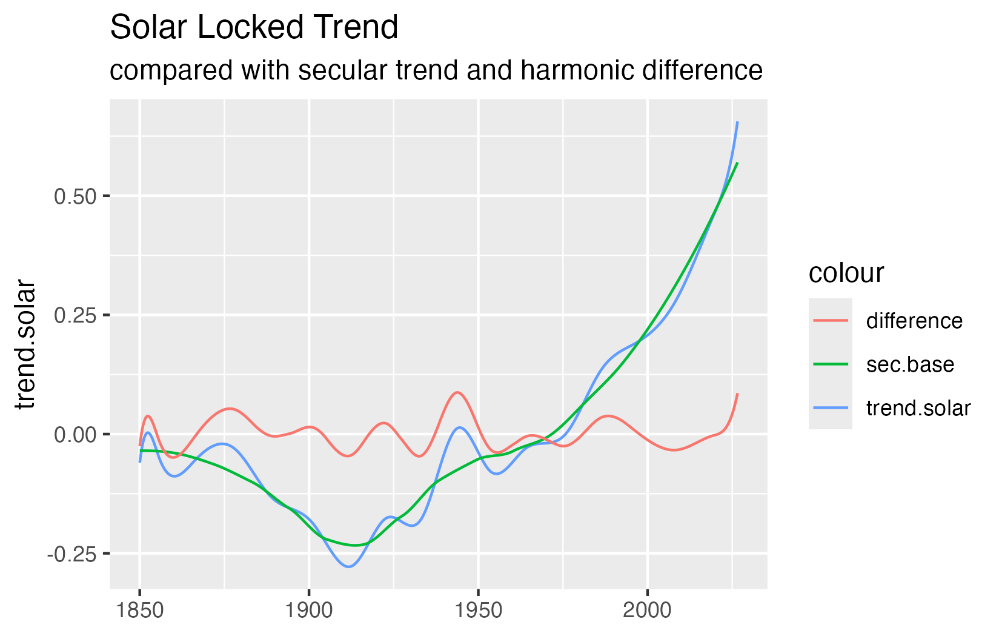
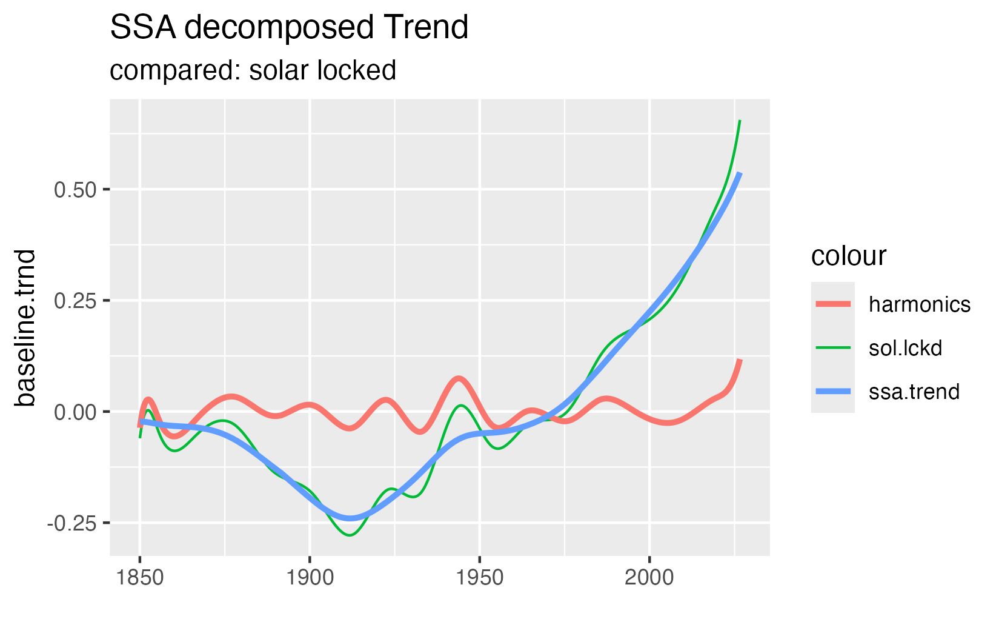
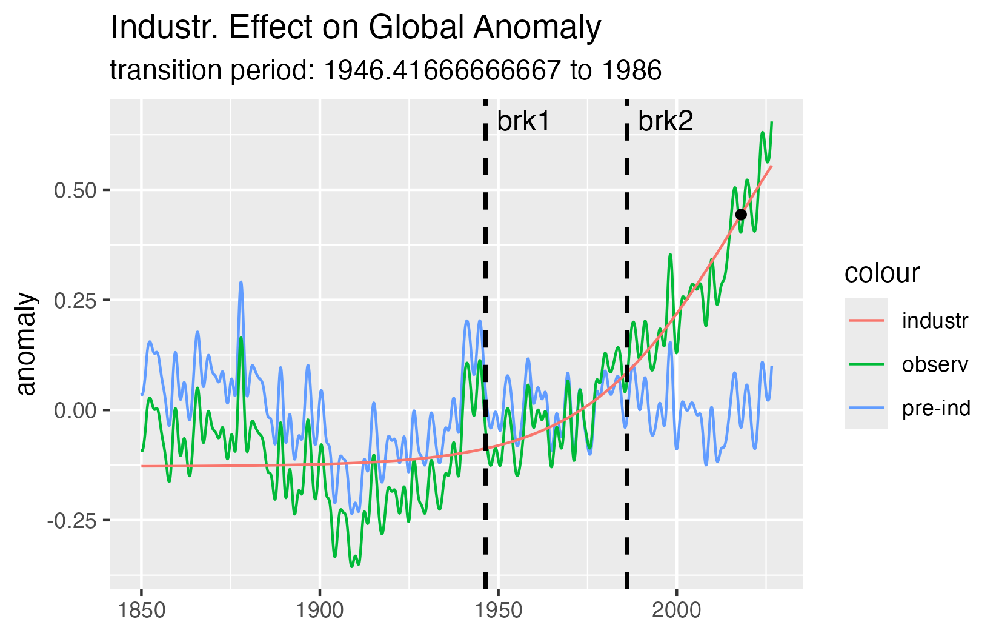
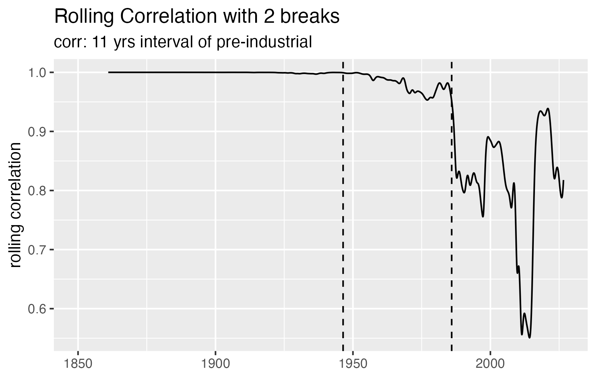
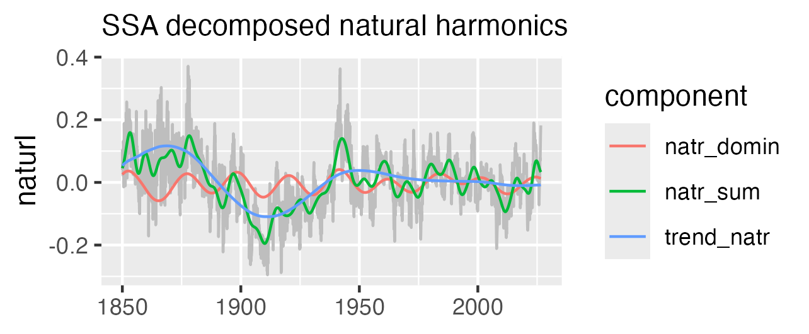
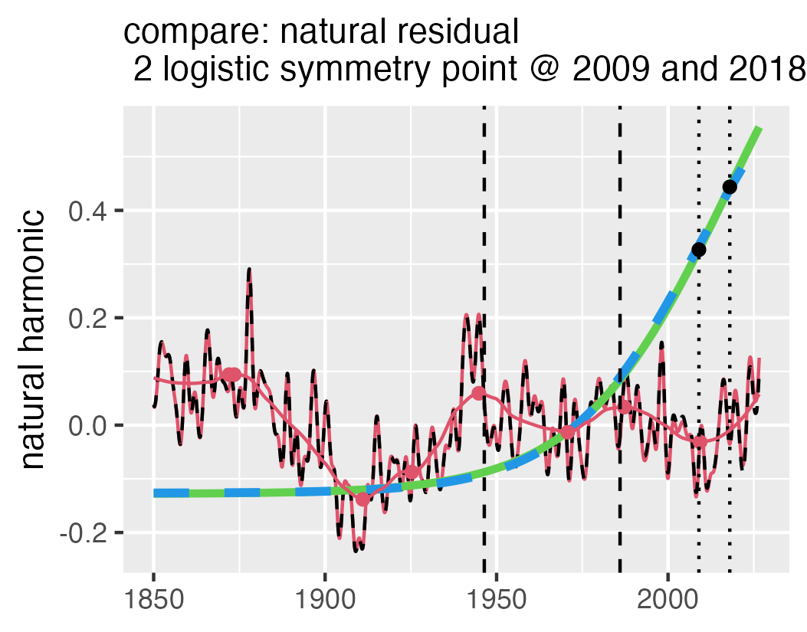

```{r setup}
library(tidyverse)
library(Rssa)
library(itsmr)
library(minpack.lm)
library(splines)
library(gsignal)
library(slider)
library(knitr)
library(terra)

# Analysis constants used with itsmr
M.ssn <- c("season", 12, "season", 6)
```

## Abstract

Global ocean heat content accounts for the vast majority of Earth’s surface thermal capacity. Anthropogenic greenhouse gas emissions disturb the equilibrium of incoming solar and outgoing longwave radiation; while both components are attenuated, the retention of outgoing thermal radiation dominates, driving persistent heat content growth.

Mathematically, ocean thermal dynamics can be modeled as a system of coupled oscillators driven by multi-decadal solar irradiance cycles. Observed sea surface temperature (SST) anomalies integrate these long-term dynamics alongside short-term seasonal and meteorological "noise", necessitating a clear separation of secular trends from internal periodic variations.

Using NOAA ERSSTv6 global area-weighted sea surface temperature (SST) anomalies (1850–2026), we extract background secular trends using three complementary approaches: (1) solar-cycle phase locking using splines, (2) non-parametric Singular Spectrum Analysis (SSA), and (3) non-linear logistic growth modeling. Rolling-correlation analysis reveals distinct structural breaks matching the early acceleration phase of the modern times rise of the SST. These breaks mark a mid-century transition regime where anthropogenic warming begins to obscure natural periodic variability.

Our findings demonstrate that historical multi-decadal hiatuses—specifically around \~1910 and between 1940 and 1970—are driven by destructive phase alignments of natural cycles rather than shifts in external forcing @medhaug2017reconciling. While sigmoidal growth curves successfully isolate the monotonic anthropogenic trajectory, post-inflection data through 2026 remain insufficient to establish a hard physical upper asymptote for ocean heat uptake.

To evaluate the human contribution, long-term natural periodic variability is separated from the underlying anthropogenic trend.

## Introduction

The global ocean acts as a massive thermal reservoir absorbing the solar forced heating. Thermodynamic laws are the principal forces trying to obtain equilibrium between the various ocean basins. Huge atmospheric and oceanic currents transport the heat and are observed as oscillations. Some of these are stable for centuries others change with seasonal or daily periods.

Mathematically, large-scale oceanic thermal adjustments can be conceptualized through coupled-oscillator frameworks. Analogous to the ‘recharge oscillator’ mechanics developed for equatorial ocean dynamics by @burgers2005simplest , global sea surface temperature anomalies integrate delayed subsurface and boundary feedback responses, which manifest as prominent multi-decadal periods when stripped of secular trends.

This physical system can be conceptualized through three main dynamics:

1.  *Coupled Solar Driving:* The ocean behaves as a set of non-linear coupled oscillators driven by periodic variations in solar irradiance across Schwabe (\~11-year), Hale (\~22-year), and Gleissberg (\~88-year) cycles.
2.  *Radiative Imbalance:* Anthropogenic emissions of long-lived greenhouse gases alter the planetary energy balance primarily by retarding outgoing longwave thermal radiation emitted primary in the northern hemisphere but distribute with a time lag of \~ 2 years across the full global surface ($4\pi R^2$). While local atmospheric processes also affect incoming solar irradiance, the net global energetic disturbance is overwhelmingly dominated by the retention of outgoing thermal radiation over the total ocean area.
3.  *Signal Disentanglement:* Isolating the anthropogenic warming trend requires separating the underlying secular trajectory from natural, multi-decadal oscillatory modes.

Traditional Fourier-based spectral filtering and linear detrending needs to be combined with a separation of the dominant periods (*principal component analysis*) to understand the effect of the periodical varying solar input.

In this study, we apply splines to lock the anomaly to solar irradiance, paired with non-parametric Singular Spectrum Analysis (SSA) and sigmoidal growth curve modeling to isolate natural cyclical variations from anthropogenic warming without enforcing artificial linearity or spectral symmetry.

## Data and Pre-Processing

### NOAA ERSSTv6 Global Ocean Anomalies

Global monthly sea surface temperature (SST) fields are obtained from the NOAA Extended Reconstructed Sea Surface Temperature version 6 (ERSSTv6) covering January 1850 through 2026 [@huang2025ersstv6]. Spatial operations on the $180 \times 90$ global grid ($2^\circ \times 2^\circ$ resolution) were executed using the `terra package` [@Hijmans2026]. Global ocean mean anomalies were generated using an area-weighted ocean mask based on Berkeley Earth grid boundaries [@rohde2020berkeley]. Annual and semi-annual seasonal signals were removed using the `itsmr package` [@Weigt2025].

To account for high-frequency vortex and weather noise, both mean and median anomaly metrics were extracted across the time series. As shown with @fig-Global-SST-Anomaly the median anomaly series exhibits a lower overall slope and a narrower dynamic range. Beyond 2000, the lower bound of the median series approaches that of the mean anomaly, reflecting the physical lower limit of seawater freezing points versus nearly unconstrained upper atmospheric warming spikes. For primary modeling, we prioritize the area-weighted mean SST anomaly, as it strictly conserves enthalpy and total thermal energy, while using the median to verify against localized polar amplification artifacts. Although we attempt to analyze the change of the global ocean heat content, we take SST as a proxy because of the available data processed and published by NOAA @huang2025ersstv6

```{r glob mean median}
#| include: false
#| warning: false
library(tidyverse)
source("scripts/Ocean_mean.median_ts.R")

```

{#fig-Global-SST-Anomaly fig-align="center" width="85%"}

### Solar Irradiance Proxy (1749–2026)

A very extensive analysis of the solar irradiation is published by [@lean2018estimating] covering paleontologic times until today. We use a simplification of the method as input data for our analysis covering the time from 1850 to 2026. The model evaluates long-term solar activity using daily sunspot numbers from WDC SILSO v2.0 [@SILSOSunspotCounts2015]. From the smoothed time series irradiance variations are calculated using satellite-calibrated quadratic polynomial transformations [@ambelu2011estimation].

```{r solar irrad ext}
#| include: false
#| warning: false
source("scripts/Solar_irrad_extended.R")

```

{#fig-sol-power fig-align="center" width="85%"}

The solar power series is decomposed using SSA to map long-term modulation envelopes, including the Gleissberg - (\~88 years), Hale cycle (\~20 years) and Schwabe cycle.The Schwabe cycle's \~11-year period is transformed into \~22 years as power is approximated by a 2nd-degree polynomial. The irradiation variance calculated from the Schwabe cycle shown as the blue line and Hale cycle as red line periods.

## Physical Framework & Signal Decomposition

The @fig-Global-SST-Anomaly of the global ocean anomaly suggests a strong upwards trend around \~ 1950. A standard methods to calculate this decomposition is an approximation with polynomials or repeated differentiation @brockwell2016introduction. Both methods gave questionable results with the ocean anomaly time series: Polynomials need to made a decision on the degree used for fitting and the result depends on this. Differentiation produces high frequencies with the data complicating further analysis. In addition extended polynomials violate the physical boundaries of ocean anomalies.

Locking the SST anomaly to the periodic changing solar irradiation gives physical correct model. The second method *Singular Spectrum Analysis* @golyandina2001 includes the extraction of the dominant harmonic periods by principal component analysis (PCA).

Both methods include no physical derived criterion or method to separate the effect of greenhouse gases from the natural periodic changes of the anomaly.This is achieved by regression to a mathematical model that respects the physical constraints of SST. A lower limit ( the freezing point of seawater) and an upper limit caused by increased evaporation and as consequence cloud formation. Such a limit of $\approx 35°C$ we observe in some partial ocean areas.

### Solar-Locked Baseline and Natural Periodic Changes

By connecting the observed SST to the solar cycle minima, a **solar-locked baseline** is established. Subtracting this baseline yields a stationary residual vector containing multi-decadal periodic variability without monotonic secular trends.

```{r sol locked trend}
#| include: false
#| warning: false
source( here::here("scripts","Solar_locked.trend.R"))

```

A LOESS smoothing fit ($\text{span} = 0.25$, $\approx 44$ years) [@cleveland1988] isolates the background trajectory (sec.base;green line). The difference between the solar-locked trend and the secular baseline highlights a primary \~22-year oscillation corresponding to the Schwabe power cycle and the \~20-year Hale cycle.

{#fig-sol-lckd-trend fig-align="center" width="85%"}

### Singular Spectrum Analysis (SSA)

The dominant periods, are extracted from the observed SST anomalies using Rssa package [@golyandina2014rssa]. An embedding window of $L = 703$ months ($\approx 58.6$ years, or $\approx N/3$) was selected to cleanly resolve multi-decadal modes without distorting boundary values.

```{r ssa decompose trend}
#| include: false
#| warning: false
library(here)
source(here::here("scripts","SSA_decomp_logistic.R"))

```

{#fig-ssa-decomp fig-align="center" width="85%"}

The ssa.trend consists of the first two components, the harmonics represent the components 3 to 20 . Comparing @fig-ssa-decomp with the @fig-sol-lckd-trend shows that the main harmonics calculated with SSA look very similar to the difference of the solar locked trend and the secular reference. The intuitive solar locked method gives very similar results to the mathematical derived decomposition. The SSA method can be applied also to the residuals of the anomaly providing a consistent method for ocean analysis.

## Anthropogenic Trend & Growth Modeling

### Logistic and Richards Growth Curve Fitting

Assuming limits on SST the secular anthropogenic component is modeled using sigmoidal growth functions. The initial effect of the irradiation unbalance on the SST is observed as an upward trend expanding the historical stable range of the anomaly. A mathematical model must also respect an upper limit asymptotical. An upper limit is clearly observed with the "West Pacific Warm Pool" a partial basins of the global ocean. A sigmoidal function can map both. Hence as a very simplified model we fit a standard symmetric logistic curve:

$$
y(t) = b + \frac{L}{1 + e^{-k(t - t_0)}}
$$ {#eq-logistic}

An asymmetric Generalized Logistic (Richards) growth curve could conceptually capture the upper and lower limit different. However, fitting the Richards curve failed due to matrix singularities during optimization. This numerical failure points to a deeper physical cause: the global anomaly time series aggregates vast spatial areas, thereby diluting the sharp regional feedback mechanisms—such as the regional recharge/discharge limits observed in smaller sub-basins—that are required to mathematically constrain an additional asymmetry parameter.

$$
y(t) = L_r + \frac{\Delta}{\left(1 + e^{-k(t - t_{0r})}\right)^{1/\nu}}
$$ {#eq-richards}

where $t_0$ represents the inflection point, $k$ is the growth rate, and $L$ denotes the upper asymptotic limit.

{#fig-sigmoid-ssa-low fig-align="center" width="85%"}

@fig-sigmoid-ssa-low shows the lowpass filtered series (observed,green line); the "industrial trend" (red line); the inflection point of the sigmoid: dot at $t_0 \approx 2018$; and the residuals (pre-ind, blue-line)

With data extending to 2026, post-inflection observations ($\sim 8$ years) provide initial curvature constraints but are insufficient to establish the exact physical asymptote ($L$). In this context, the fitted limit reflects short-term mixed-layer heat capacity and thermal inertia rather than a final ceiling on global climate change.

### Structural Break & Natural Residual Analysis

```{r rolling cor}
#| include: false
#| warning: false

source(here::here("scripts","Rolling.cor_anomaly_ssa.R"))

```

Subtracting the sigmoid growth model @fig-sigmoid-ssa-low (industr) from the total anomaly (observed) yields the **pre-industrial natural residual** (pre-ind). An 11-year rolling correlation between the observed anomaly and natural reconstruction shows high correlation until brk1 $\sim 1950$, where a clear structural break indicates the transition into an anthropogenic-dominated climate regime.

{#fig-rolling-cor fig-align="center" width="85%"}

The two vertical lines @fig-rolling-cor (brk1 and brk2 breaks of the correlation) mark the transition period and are also shown in @fig-sigmoid-ssa-low.

## Discussion & Results

### Logistic Inflection 2009 Phase Anchor, and Asymptotic Constraints

A critical question in interpreting the non-linear trajectory is the timing of the logistic curve's inflection point. While unconstrained logistic regression places the symmetry point near 2018 , the natural harmonic minimum is firmly anchored near 2009 @fig-nat-har. By restricting the logistic regression through the 2009 phase minimum and verifying that recalculated natural residuals remain virtually identical, we confirm an iterative, physically consistent correction robust against circular logic. Correcting the turning point to 2009 naturally lowers the model's fitted upper asymptote ($L$). Nevertheless, this adjusted asymptote reflects short-term mixed-layer heat capacity rather than a definitive physical ceiling on global warming. A full accounting of upper thermal bounds requires integrating regional regime-shift dynamics and boundary-layer feedbacks highlighted by structural break analysis.

{#fig-natrl-ssa-decmp fig-align="center" width="85%"}

### Key Findings

By strictly separating solar-locked natural cycles from the secular warming trend, this analysis provides a physical baseline for ocean heat uptake that avoids polynomial overfitting and empirical distortion.

{#fig-nat-har fig-align="center" width="85%"}

### Structural Breaks and the 1940–1970 Hiatus

During the 1940–1970 hiatus, accelerating greenhouse warming was temporarily offset by the downward phase of natural multi-decadal harmonics, masking underlying secular acceleration.

- **Hiatus Dynamics:** The mid-20th-century warming slowdown (1950–1970) is primarily explained by destructive phase interference between natural solar harmonics (notably the \~22-year Hale cycle) and ocean thermal lag, rather than purely external aerosol forcing.
- **Secular Trajectory:** Isolating the anthropogenic mode via SSA demonstrates a continuous, monotonic warming trajectory that aligns with cumulative planetary energy imbalance and thermodynamic enthalpy conservation.
- **Regime Stability:** Structural break testing confirms that multi-decadal oscillations act as superposed periodic variations around a single, evolving non-linear warming baseline.

### Future Work

This diagnostic framework will be extended to basin-specific regional SST anomalies (Atlantic Multidecadal Oscillation and Pacific Decadal Oscillation dynamics) to evaluate local resonance effects and regional thermal inertia differences.

### Statements and Declarations

Funding: The author declares that no funds, grants, or other support were received during the preparation of this manuscript.

Competing Interests: The author has no competing interests to declare that are relevant to the content of this article.

Data Availability: Global monthly sea surface temperature anomaly fields are publicly available from the NOAA Extended Reconstructed Sea Surface Temperature version 6 (ERSSTv6) repository at https://www.ncei.noaa.gov. Daily sunspot numbers are available from WDC SILSO v2.0 at https://sidc.be/silso/.

Code Availability: The complete analysis pipeline, Quarto source documents, and R scripts supporting the findings of this study are openly archived in the public GitHub repository https://github.com/aloes2512/Ocean_Analysis.

### Acknowledgments

Artificial Intelligence assistance (Google Gemini) was utilized strictly as an auxiliary tool for verifying R processing scripts, optimizing Quarto syntax formatting, and refining text grammar. The mathematical conceptualization, thermal dynamics framework, data analysis, and scientific conclusions were developed independently by the author.
```{r}
#| echo: false
#| include: false
#| message: false
#| warning: false

library(here)

pdf_filename <- "Ocean_Analysis.pdf"
source_file <- here(pdf_filename)
dest_dir <- here("Draft_Report_files")
dest_file <- file.path(dest_dir, pdf_filename)

if (file.exists(source_file)) {
  if (!dir.exists(dest_dir)) {
    dir.create(dest_dir, recursive = TRUE)
  }
  
  # Copy to destination subfolder
  file.copy(source_file, dest_file, overwrite = TRUE)
  
  # Brief pause to ensure the PDF process releases the file handle, then remove
  Sys.sleep(0.5)
  unlink(source_file)
}
```

